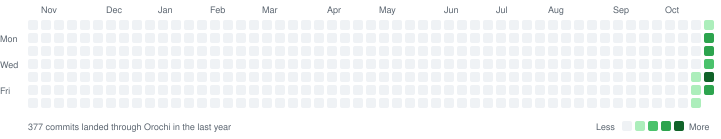

## Hi, I'm Nu11ified 👋

I build developer infrastructure, ML tooling and the occasional programming language. Lately: a home-grown source control and landing system, ROCm support for Candle, and GitForge, a Git LFS based GitHub alternative.

### Orochi commits

Every commit I've landed on our monorepo's `main` through Orochi, our own source control system.

<picture>
  <source media="(prefers-color-scheme: dark)" srcset="assets/orochi-map-dark.svg">
  
</picture>

<!-- Refresh: ./refresh.sh -->

### Projects

| Project | What it is |
|---|---|
| [candle-rocm](https://github.com/Nu11ified/candle-rocm) | Experimental ROCm support for the Candle ML framework |
| GitForge | A Git LFS based GitHub alternative, with Go, Python and TypeScript SDKs |
| [polylab](https://github.com/Nu11ified/polylab) | Algorithm research assistant |
| [spbox](https://github.com/Nu11ified/spbox) | FiveM framework on SpacetimeDB, QBCore and Qbox compatible |
| [kiai-hub](https://github.com/Nu11ified/kiai-hub) | Kendo tournament management |
